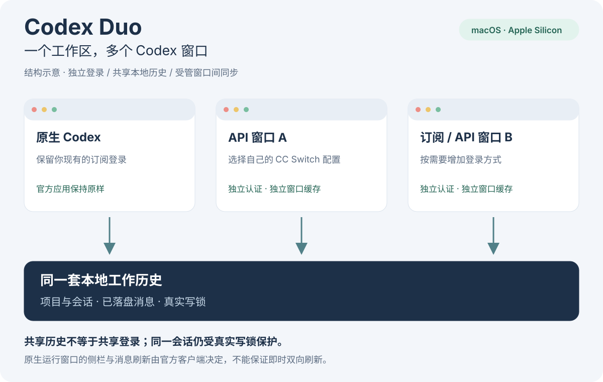
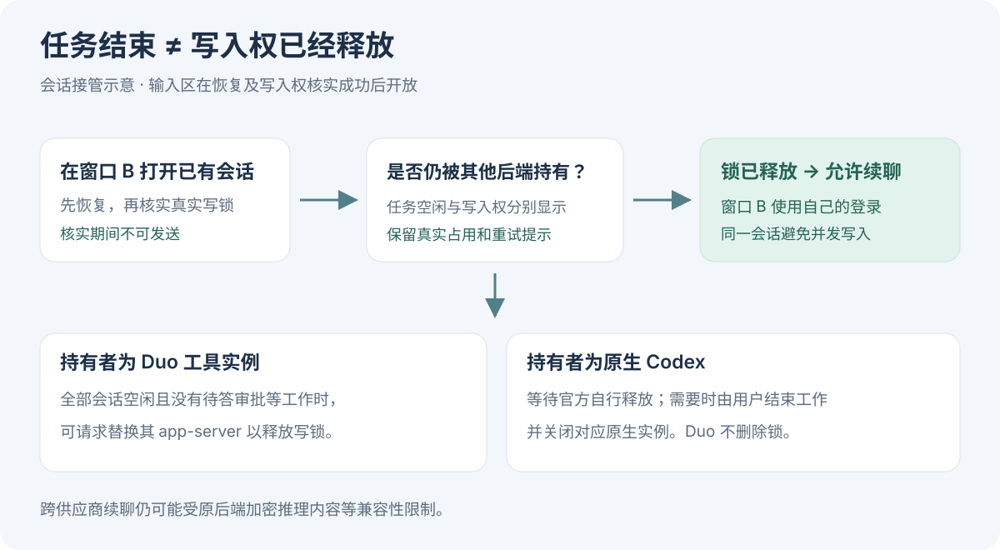

<div align="center">

# Codex Duo

**一个工作区，多个 Codex 窗口。**

在 macOS 上为 Codex 添加独立登录的额外窗口，共享本地项目与会话。

[快速开始](#快速开始) · [使用图解](#使用图解) · [从源码构建](#从源码构建) · [完整使用说明](docs/usage.md)


[](LICENSE)

</div>



> 社区独立项目，与 OpenAI 无关联或官方背书。当前是 **0.7.2 / build 21 实验版本，提供源码与 Apple Silicon 应用包**。应用包不内置 Codex 引擎；运行时从本机原生 Codex 生成受管副本，按实际接口结构自动识别兼容性。默认构建为 ad-hoc 签名，尚未完成 Developer ID 签名与 Apple 公证。

## 为什么使用 Duo

你可以保留原生 Codex 窗口的订阅登录，再添加使用不同 API 配置或其他订阅登录的窗口。每个窗口保存自己的登录和缓存，工作仍留在同一套本地历史里。

| 能力 | 当前行为 |
| --- | --- |
| 多个登录环境 | 创建 API 或订阅实例；API 配置来自用户选择的 CC Switch 供应商 |
| 共享本地工作区 | 受管窗口同步项目、会话列表、排序、置顶和已打开会话的消息增量 |
| 实时状态 | 分别显示任务执行状态、真实写入权和持有者 |
| 独立命名 | 实例名称显示在窗口标题、Dock 和应用菜单；停止后可改名 |
| 本地管理 | 关闭后重开复用实例应用；删除实例清理其登录、配置和缓存，保留共享历史 |
| 保留原生环境 | 只改造工具拥有的应用副本；官方配置、认证及 CC Switch 配置作为只读输入 |

启用共享后，工具会向原生 Codex 的本地历史写入新工作。认证隔离并不意味着历史隔离，详见 [本地数据与隐私](PRIVACY.md)。

## 快速开始

从 [GitHub Release v0.7.2](https://github.com/Empress7211/Codex-Duo/releases/tag/v0.7.2) 下载 `Codex-Duo-0.7.2-macos-arm64.zip`，解压后将 `Codex Duo.app` 拖入“应用程序”。Release 中的 “Source code” 下载项用于自行构建。应用包内含 Python 运行时。

**准备条件**

- Apple Silicon Mac，macOS 14 或更新版本。
- 自己安装的官方 Codex。优先检测 `/Applications/Codex.app`，其次检测 `/Applications/ChatGPT.app`；版本号变化不会单独阻止启动。
- API 模式：在自己的 CC Switch 中配置 Codex API 供应商。订阅模式：在新实例内登录自己的账号。
- 自行构建还需要 Xcode Command Line Tools、可重定位的 portable Python 3.11+ 和本地图标素材，详见[构建步骤](#从源码构建)。

将完整的 `Codex Duo.app` 复制到 `/Applications`，再打开：

```sh
open -n '/Applications/Codex Duo.app'
```

仓库中的 `打开工具.command` 也会打开上述安装位置。当前应用使用 ad-hoc 签名。如果 macOS 阻止打开，请在“系统设置 → 隐私与安全性”中选择“仍要打开”，按系统提示确认。

## 使用图解

以下图片是根据当前代码绘制的操作示意，使用示例名称，不是真实账号或运行截图。


1. 在“实例”页点击 **连接共享工作区**。初始没有额外窗口，也不复制原生 OAuth 登录。
2. 点击 **＋ 新增实例**，选择 API 实例或受管订阅实例，并填写名称。
3. API 实例选择供应商并点击 **保存 API 配置**；订阅实例启动后自行登录。
4. 点击 **启动**。已有窗口使用 **显示窗口** 唤起；在“实时会话”页查看执行状态与写入权。

关闭 Duo 管理窗口不会关闭已经打开的实例。改名、配置供应商和删除操作要求对应实例停止；共享配置同步和工作区切换要求所有工具实例停止。升级前先结束相关任务，正常关闭受影响实例。

### 共享和同步到哪里

| 方向 | 能同步什么 | 边界 |
| --- | --- | --- |
| Duo ↔ Duo | 项目、会话列表、置顶排序、执行状态、打开会话的消息增量 | 登录、浏览器缓存和当前选中项各自独立 |
| 原生 Codex → Duo | 项目、会话、可观察的执行状态、已落盘消息和结果 | 原生流式文字未逐字落盘，不能逐字镜像 |
| Duo → 原生 Codex | 新工作写入同一套本地会话历史 | 运行中的原生侧栏与消息刷新由官方客户端决定，不保证即时显示 |

远程 SSH 状态、ChatGPT 云端聊天、定时任务和浏览器状态不属于共享范围。

### 同一个会话能在另一个窗口续聊吗



工具核实写入权后才开放输入。受管持有者全部工作空闲且没有待答审批等未完成工作时，可通过现有接管机制释放缓存写锁；原生持有者由官方自行释放。工具不会删除锁或重启原生后端。

不同供应商对加密推理内容的支持可能不同。遇到明确的后端不兼容错误，应使用原后端或新建聊天，不能认为共享历史就保证跨供应商无条件续聊。

## 从源码构建

构建只打包 Duo 管理器和 Python，不包含 Codex 引擎。运行时只读检测本机原生 Codex，按需创建并修改工具拥有的副本。

```sh
git clone https://github.com/Empress7211/Codex-Duo.git
cd Codex-Duo
xcode-select --install  # 已有 Swift 工具链时跳过
```

1. 按 [assets/README.md](assets/README.md) 从自己的兼容客户端准备本地图标。图标源文件及衍生素材均不上传仓库。
2. 准备 **可重定位的 portable Python 3.11+**，其中包含 `bin/python3`、标准库及 `lib/python*/LICENSE.txt`。普通 Homebrew Python 不能直接视为可移植运行时；打包器会检查重定位与外部动态库依赖。
3. 指定自己的 Python 运行时执行构建：

```sh
./build.sh --python-runtime /absolute/path/to/portable/python
```

输出为仓库根目录的 `Codex Duo.app`。源码后端只使用 Python 标准库；用户运行构建后的完整应用时无需另装 Python。若共享历史含 `.jsonl.zst` 文件，还需 Python `compression.zstd` 或本机 `zstd` 命令，缺少解码能力会停止迁移。

```sh
# 查看选项，不执行构建
./build.sh --help

# 发布者可选：选择本机构建签名身份
./build.sh --python-runtime /absolute/path/to/portable/python \
  --sign-identity 'SIGNING_IDENTITY'
```

`--sign-identity` 不会自动完成 Hardened Runtime 或公证。`--runtime-root` 用于隔离开发数据，普通构建使用默认值，不应把本机测试路径放入分发包。源码开源不代表有权再分发官方引擎与第三方图标，详见 [第三方说明](THIRD_PARTY_NOTICES.md)。

## 数据、升级与卸载

默认私有数据目录：`~/Library/Application Support/Codex Duo/runtime`。实例认证可能保存在其 `codex-home/auth.json`；桌面加密密钥使用 macOS Keychain 的 `Codex Duo Vault`，这不代表整个 runtime 都被加密。

- **关闭实例**：保留应用、登录和缓存，后续可从管理器、Finder 或 Dock 重开。
- **删除实例**：在管理器停止后删除，清理该实例及其路径引用，保留共享项目与会话。不要先手动删 runtime。
- **备份**：停止相关写入者，同时备份官方共享历史；runtime 中的历史软链接不构成完整备份。
- **升级**：结束相关工具任务并关闭窗口，再替换管理器。官方客户端更新后，已停止的实例在下次启动时自动从新版原生生成副本；运行中的实例继续使用原副本直到退出。登录、配置和历史保留。旧 Orbit 数据与加密缓存不自动迁移。

完整的同步机制、恢复与存储说明见 [使用详解](docs/usage.md)。

## 已知限制与验证状态

跨对话读取由 Duo 的 `duo_history` 只读 MCP 提供 `list_threads` 和 `read_thread`。可按标题查找，再用会话 ID 或 `codex://threads/...` 链接读取已落盘消息，支持分页及按需读取工具记录。范围为当前共享的本地 Codex 历史。新建实例、同步配置和启动时自动接入，并修正内置插件市场的实例路径。

官方内置工具使用原生副本中保留官方签名的 Node 和 CLI。Python 观察器通过官方 Node 托管 CLI，使工具进程及其父、祖父进程满足原生签名检查。已验证原生连接鉴权、CLI 握手及转发生命周期，侧边栏浏览器的完整窗口操作仍待实测。真实模型请求、订阅登录、全新机器安装、完整网络流量审计及正式签名公证，均不在当前已通过的开发验证范围内。

0.7.1 对历史加载、分页基线和完成事件去重做了离线定向回归；未启动客户端做界面验收。升级后重新打开受管窗口生效；之前已持久化的未读提示可在会话菜单中标记已读，更新不会批量清空真实未读。旧版已有的生命周期验证不能证明新版界面行为。证据见 [验证记录](docs/validation.md)，当前行为见 [发布说明](RELEASE.md)。

## 项目结构与参与贡献

```text
source/             Swift 管理器与实例入口、Python 后端、受管同步桥接
assets/             图标生成脚本及本地素材准备说明
docs/              使用详解、验证摘要和原创操作图解
build.sh            本地构建入口
PRIVACY.md          数据读取、写入、联网与删除边界
THIRD_PARTY_NOTICES.md  第三方组件及许可范围
```

欢迎提交 [Issue](https://github.com/Empress7211/Codex-Duo/issues) 或 PR。报告问题时请提供 macOS / 芯片型号、Duo 与官方客户端 build、复现步骤和已脱敏的错误信息。不要上传 `auth.json`、API key、CC Switch 数据库、完整 runtime 或私人会话。

更新时按实际启动入口、同步与写入权接口自动定位补丁，文件哈希后缀、压缩变量或 build 变化无需手改。若关键接口被删除或定位有歧义，会提示具体不兼容点并保留原副本；不能保证任意未来架构都自动兼容。当前构建产物、本机开发笔记、认证和第三方图片由 `.gitignore` 排除。

## 许可证

原创代码与文档使用 [MIT License](LICENSE)。第三方软件、商标和本地生成图标不在该授权范围内，详见 [第三方说明](THIRD_PARTY_NOTICES.md)。
